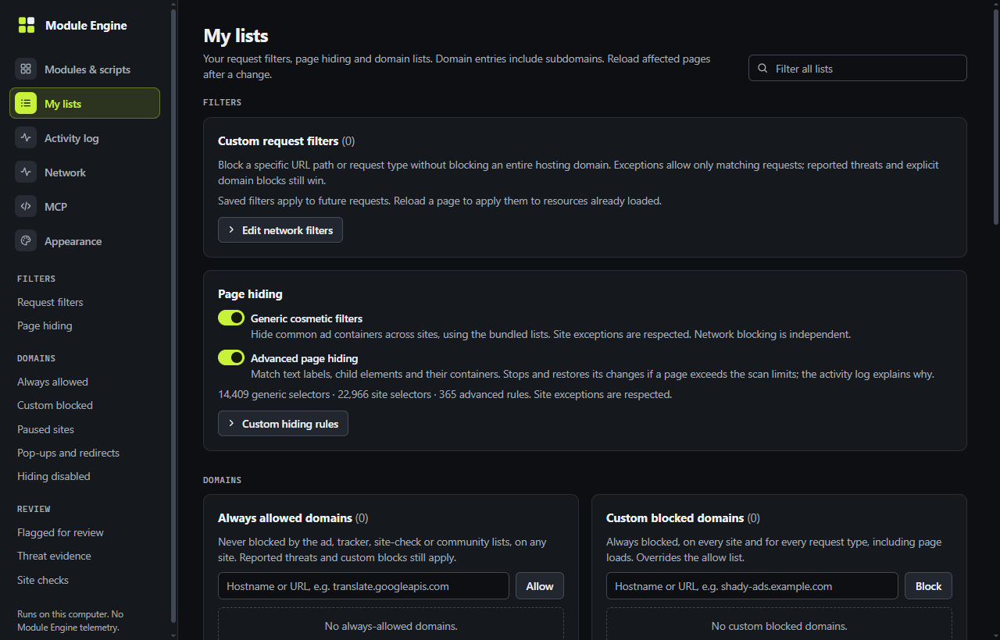

# Module Engine

A modular browser extension for **Chrome, Edge and Firefox**, combining local ad blocking with an optional userscript manager.

Module Engine uses the browser's Manifest V3 APIs and bundled filter data. Ad blocking and userscripts run entirely in the extension. An optional local MCP server provides explicitly approved debugging that is read-only by default; it needs an installed Node runtime but no packages. Formerly **BlockAds Shield**.

The [project site](site/index.html) gives a one-page overview with install steps and a comparison with Violentmonkey, Tampermonkey, Greasemonkey and uBlock Origin. Open it in any browser; it loads nothing from other sites.

## Screenshots


| Toolbar popup | My lists |
| :---: | :---: |
|  |  |


These show the dark theme with the default lime accent in Chrome. The scripts are samples, and the popup is shown as it appears on `example.com`.

## Features

- **Independent modules:** pause ad blocking without disabling userscripts, or keep the userscript module off entirely.
- **Ad and tracker filtering:** bundled network rules, EasyList snapshots, cosmetic hiding, advanced page hiding and a visual element picker.
- **Custom controls:** blocked domains, allowed domains, per-site exceptions and scoped request filters.
- **Pop-up protection:** an optional per-site guard for pop-ups, embedded-frame takeovers and scripted page changes, including server-redirect chains stopped before their first request. Ordinary links and video controls remain usable; see the [scope and compatibility limits](docs/USER_GUIDE.md). New tabs whose first page load was confirmed blocked are closed automatically. Existing, pinned and uncertain tabs stay open ([details](docs/USER_GUIDE.md#controls-and-scope)).
- **Reddit app prompts:** Page hiding removes recognized app-promotion overlays and releases their click and scroll locks. Coverage is tested with offline fixtures; live Reddit layouts can vary.
- **Prompt protection:** blocks new page notification requests and hides recognized notification reminders and install-to-play/download overlays. Separate switches and trusted-site exceptions keep ad blocking active. See [coverage and limits](docs/USER_GUIDE.md#notification-and-install-prompts).
- **Deceptive button protection:** stops recognized play/download actions inside ad placements, external links covering real video players and Play links to installers/scripts. Ordinary downloads remain available; this is conservative detection, not a file scanner. See [controls and limits](docs/USER_GUIDE.md#deceptive-play-and-download-buttons).
- **Userscripts:** import, edit, enable and export `.user.js` files, or install them from a URL or an opened `.user.js` link after review. Daily `@downloadURL`/`@updateURL` checks stage newer versions for your approval; nothing is applied silently ([installs and updates](docs/USER_GUIDE.md#installing-and-updating-scripts)). Scripts get GM storage, listeners, page commands, DOM/tab helpers, clipboard writes, notifications, downloads, scoped cookie access, extended URL matching, cached dependencies/resources and bounded cross-origin HTTP requests. Execution supports `unsafeWindow` in the selected world, `@top-level-await` and `@unwrap` with any supported scope; see the [compatibility limits](docs/USER_GUIDE.md#execution-compatibility).
- **Script installation and updates:** install from a direct URL, then check for updates yourself or wait for the daily check. Every replacement shows its source and access for approval first, and saved values are retained.
- **Editor tools:** syntax highlighting and errors, metadata suggestions, tags and execution order. An optional authenticated localhost helper tracks one external `.user.js` file; changes enter a draft only when you choose. See [editing and external-file setup](docs/USER_GUIDE.md#editing-and-organizing-scripts).
- **Local activity and review:** inspect extension events, supported blocked-request logs and suspected-ad flags before choosing what to block.
- **Appearance:** choose a system, light or dark theme and an accent colour (seven presets or any custom colour) for the popup and every Module Engine page. Accent text and edges adjust to stay readable in both themes. Optionally, light websites follow the dark theme too, with per-site exceptions. See [appearance](docs/USER_GUIDE.md#appearance).
- **MCP debugging:** let an agent inspect module status, scripts, URL matching and bounded activity/errors through an explicitly approved local session. Stdio is the default; authenticated localhost HTTP is optional. See [setup and capture limits](docs/MCP.md).
- **Agent script proposals (opt-in):** with `--allow-changes` and a separate approval, an agent can propose new scripts, edits and on/off changes. Each one waits on the MCP page with the same access and source review as a URL install; nothing is saved until you apply it, applied scripts stay off unless you choose Apply & enable, and agents cannot delete scripts. See [script change proposals](docs/MCP.md#script-change-proposals).

## Getting started

The extension is currently installed from source. The blocker declares Chrome/Edge **121+** and Firefox **128+** as minimum versions; the optional userscript module also needs the browser's native `userScripts` API and permission controls.

### Chrome and Edge

1. Open `chrome://extensions` or `edge://extensions`.
2. Enable **Developer mode**.
3. Select **Load unpacked** and choose the repository folder containing `manifest.json`.
4. Open **Module Engine** from the extensions menu.

To run userscripts, also turn on **Allow User Scripts** on Module Engine's extension-details page (Chrome 138 and later; earlier versions use Developer mode). After pulling or editing source files, select **Reload** on the extension's browser page, then reload affected website tabs.

### Firefox

1. Open `about:debugging#/runtime/this-firefox`.
2. Select **Load Temporary Add-on**.
3. Choose this repository's `manifest.json`.

Use **Reload** on that page after source changes. A temporary add-on must be loaded again after Firefox restarts; permanent distribution requires Mozilla signing.

## Using the modules

Ad blocking and userscripts have separate switches. Userscripts start disabled.

Open **Modules & scripts** to import or create a script. Review its source and site scope, grant userscript access if prompted, save it, then enable **Run this script** and reload a matching page. Chrome and Edge may also require **Allow User Scripts** on the browser's extension-details page.

Saving an edited script disables it until you enable it again. Disabling a script prevents future registrations, revokes live APIs and cancels its network requests; reload open pages to remove code that has already run.

The editor highlights source and reports syntax errors with **Go to error**. Add local tags or author `@tag` metadata, search/filter the library, and use **Earlier** / **Later** to set script start order within each timing phase. Saving tags alone keeps the script enabled. See [editing and organization](docs/USER_GUIDE.md#editing-and-organizing-scripts).

For a hosted script, choose **Install from URL**, paste its direct HTTPS source URL, then **Fetch for review**. Review the code and access before choosing **Install script**. Later, select the script and choose **Check for updates**. **Apply update** uses the reviewed bytes, preserves saved values and pauses the script until you enable it again. See [installation and update limits](docs/USER_GUIDE.md#installing-and-updating-scripts).

Scripts can add commands to the extension popup for their page. Legacy GM reads are synchronous once saved values load; that initial loading can delay `document-start`. Modern GM storage methods return promises, and stored values remain JSON-compatible and private to each script.

Chrome and Edge support 10 isolated userscript worlds in one document. Keep overlapping script scopes within that limit; the library can still hold 32 scripts for different sites.

Page scripts can combine real `unsafeWindow` access with granted GM APIs. Wrapped `@inject-into auto` tries page first, with isolated fallback when page startup is blocked. Page code can observe or invoke the script's granted helpers; use `content` for isolation. Older saved auto scripts keep isolation until individually re-enabled. Page bridges also consume an isolated world; raw `@unwrap` auto remains isolated. See [execution behavior and limits](docs/USER_GUIDE.md#execution-compatibility).

URL scopes support host wildcards, ports, IPv6, internationalized hosts, fragments, `.tld` suffixes and regex includes/excludes, including lookarounds, named groups and backreferences evaluated with bounded work. See [matching rules and examples](docs/USER_GUIDE.md#userscript-url-matching) for the supported syntax and limits. Suffix data is bundled locally; matching makes no network requests.

For scripts with `@require` or `@resource`, save the script, choose **Prepare dependencies**, and review the cached contents before enabling it. Nothing downloads on import, save or startup. Scripts with a network grant can use `GM_xmlhttpRequest` or `GM.xmlHttpRequest`; the manager displays their destination scope.

Scripts can grant `GM_addElement` / `GM.addElement` to create DOM elements, or `GM_openInTab` / `GM.openInTab` to open HTTP(S) tabs and close their own tabs through a returned handle. Both API styles return synchronously. See the [helper options, lifecycle and compatibility limits](docs/USER_GUIDE.md#element-and-tab-helpers).

The manager supports a focused subset of userscript metadata and GM APIs. Updates are checked daily but never applied without your review, and compatibility with Violentmonkey and Tampermonkey scripts is partial. See the [compatibility table and request limits](docs/USER_GUIDE.md#modules-and-userscripts).

Clipboard, notification and download helpers need an exact `@grant` plus optional browser access. Select the script and choose **Allow helper access**. Both legacy and modern spellings are supported; downloads use HTTP(S), `@connect` scope, a 16 MiB cap and unique filenames unless `conflictAction` asks to overwrite or prompt. HTTP requests support FormData, ReadableStream bodies, `user`/`password` Basic authentication, upload progress, 8 MiB bodies/responses and up to five checked redirects. Upload progress needs helper access; Firefox also needs it to follow redirects. See [request options and limits](docs/USER_GUIDE.md#userscript-http-requests) and [desktop helper behavior](docs/USER_GUIDE.md#clipboard-notifications-and-downloads).

## Logs, network capture and MCP

Open **Modules & scripts → Network** for optional request/response metadata capture. Choose all browser traffic or one tab, then **Start new capture**. Filter requests, inspect timing/errors, pause the live view or export filtered JSON. Capture is local, off by default and bounded; it does not collect headers or bodies. See [network capture and its limits](docs/USER_GUIDE.md#network-log).

**MCP** is a sidebar entry as well as a button on Modules & scripts. Approve **Captured network request metadata** to let an agent use `module_engine_get_network_log`. Start capture yourself in a separate Network tab; the MCP tool can only read sanitized metadata. See [network approval and filters](docs/MCP.md#reading-captured-network-requests).

## How it compares

Module Engine is the only one of these extensions that both blocks ads and runs userscripts. This was checked against each project's own pages and recent reporting on 18 November 2026. The [project site](site/index.html#compare) has the detailed tables and sources.

| Extension | Blocks ads | Runs userscripts | Chrome and Edge | Firefox | Licence |
| --- | --- | --- | --- | --- | --- |
| **Module Engine** | Yes | Yes | Yes, Manifest V3 | Yes | None chosen yet |
| Violentmonkey | No | Yes | Yes; Chrome build is Manifest V3 | Yes | MIT |
| Tampermonkey | No | Yes | Yes, Manifest V3 | Yes | Closed source |
| Greasemonkey | No | Yes | No | Yes | MIT |
| uBlock Origin | Yes | No | No longer (Manifest V2) | Yes | GPLv3 |
| uBlock Origin Lite | Yes | No | Yes, Manifest V3 | Yes | GPLv3 |

The others go further in their own areas:

- uBlock Origin keeps its lists current and adds scriptlets and dynamic filtering.
- uBlock Origin Lite refreshes its rules with every store release.
- Tampermonkey and Violentmonkey cover more of the userscript API and sync scripts through cloud storage.

Module Engine's lists change only with a new build. It holds up to 32 scripts and installs from source.

## Browser support and verification

Module Engine supports Chrome and Edge 121 and later, and Firefox 128 and later.

On **18 November 2026** the current code passed:

- **624 Node tests**;
- **30 cosmetic, 237 rule/import, 342 threat and 41 requested-host assertions**;
- **789 Chrome, 789 Edge and 782 Firefox** browser checks, run offline with disposable profiles and local test pages.

That run covered the website-theme detection fix, hiding rules kept beside `name.*` wildcard sites, the 180-day reported-threat window and the Firefox userscript layout fixes. See the [verification records](docs/VERIFICATION.md) for it and for earlier dated passes, each with its own scope and limits:

- Appearance;
- same-tab MCP navigation;
- network capture and localhost MCP;
- button and prompt protection;
- page and execution compatibility;
- URL matching;
- Reddit repairs.

## Privacy and limits

Module Engine has no telemetry. Settings, script source, cached dependencies, script values and activity records stay in browser extension storage. Explicit dependency preparation downloads the listed files without cookies. Enabled scripts can read matching pages; a network grant can send data and use destination cookies unless `anonymous: true` is set. The separate cookie grant and optional permission allow reading and changing cookies, including HttpOnly cookies, within the documented host/store limits. Review code, dependencies and API access before enabling a script.

The bundled lists are manually maintained and do not update automatically; the current EasyList and EasyList China snapshots are from 19 October 2026. Ad filtering can miss ads, affect legitimate pages or vary by site. The reported-threat layer uses dated evidence and disables itself 180 days after the earliest reported observation; its current policy expires on **28 February 2027 at 00:00 UTC**. It is not comprehensive malware protection.

Permission purposes and the distinction between site pauses, allowed domains and custom blocks are documented in the [user guide](docs/USER_GUIDE.md#permissions).

## Documentation

- [Project site](site/index.html): a one-page overview, install steps and the comparison with other extensions.
- [User guide](docs/USER_GUIDE.md): modules, controls, custom filters, permissions and the element picker.
- [Development](docs/DEVELOPMENT.md): source organization, rule builds and local working files.
- [Verification](docs/VERIFICATION.md): dated results, offline test commands and explicit live-test opt-ins.
- [List contracts and provenance](lists/README.md): reviewed inputs, bundled snapshots and generated rules.
- [Project history](docs/history/README.md): dated reviews and preserved version notes.

## Development quick start

Extension source lives in `src/`, grouped into background coordination, blocking, userscripts, UI and shared code. `manifest.json` stays at the repository root, which remains the folder to load in your browser. See the [project layout and development guide](docs/DEVELOPMENT.md).

The tests use installed **Node.js 22+** and **PowerShell 7+**, with no third-party test packages. Run these from the repository root:

```powershell
node --test tests/*.test.cjs
pwsh -NoProfile -File tests/cosmetic-rules.test.ps1
pwsh -NoProfile -File tests/rules.test.ps1
pwsh -NoProfile -File tests/threat-rules.test.ps1
pwsh -NoProfile -File tests/requested-ad-hosts.test.ps1
```

Browser test commands and offline isolation details are in [Verification](docs/VERIFICATION.md#verification). Keep raw working output in `.artifacts/`; reviewed historical evidence remains under `verification/`.

## Attribution and licensing

The bundled [EasyList](https://easylist.to/) and [EasyList China](https://github.com/easylist/easylistchina/) snapshots are by the EasyList authors. Their source headers and [snapshot catalog](lists/community-lists.json) identify the upstream sources, hashes and [EasyList licence](https://easylist.to/pages/licence.html). The generated community rules are derived from those lists.

No project-wide license has been selected for Module Engine's original source. Third-party list attribution and licensing are separate from that decision. The preserved [project overview](docs/history/PROJECT-NOTES-2026-11-08.md#previous-project-overview) records the earlier references and attribution notes.
