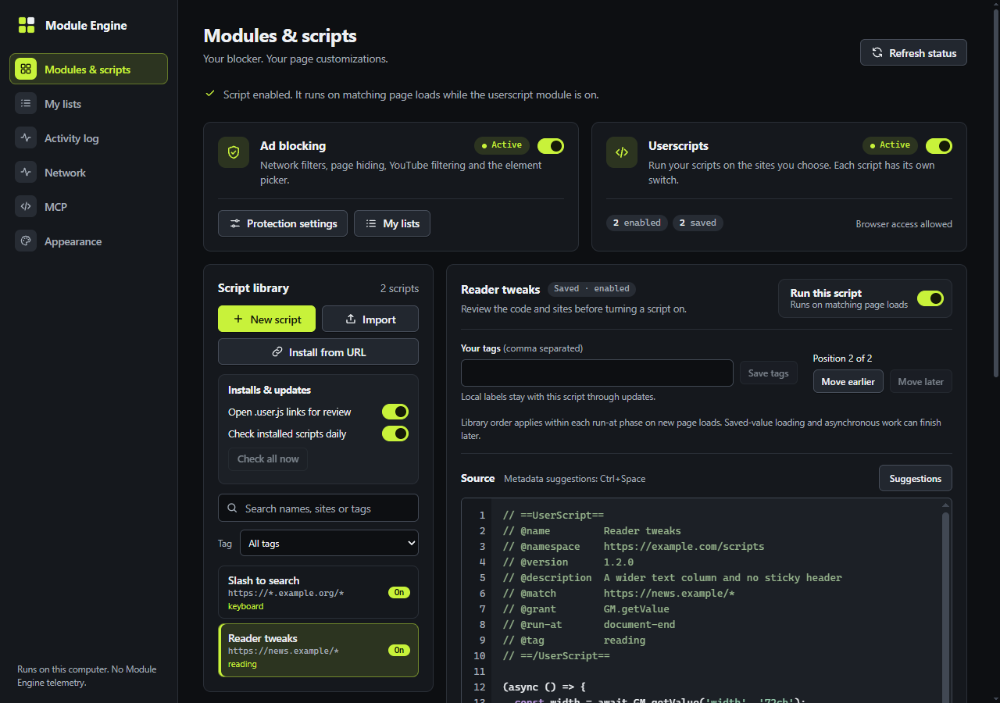
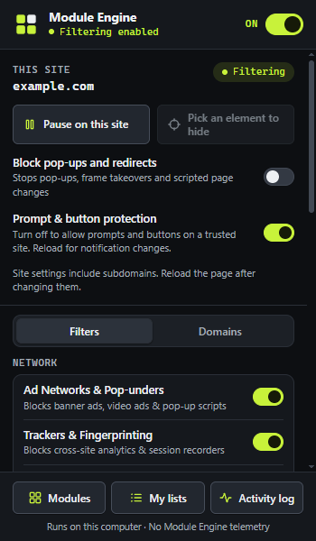
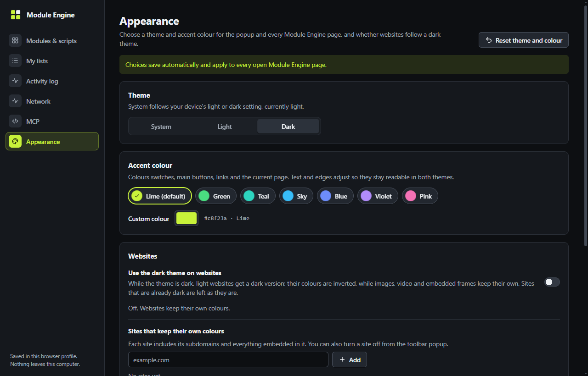

<p align="center">
  
</p>

<h1 align="center">Module Engine</h1>

<p align="center">
  <strong>Local ad blocking and userscripts, each with its own switch.</strong><br>
  A modular, open-source browser extension for Chrome, Edge and Firefox.
</p>

<p align="center">
  <a href="https://jasxtd.github.io/Module-Engine/">Website</a> ·
  <a href="#features">Features</a> ·
  <a href="#getting-started">Install</a> ·
  <a href="#using-the-modules">Quick start</a> ·
  <a href="docs/USER_GUIDE.md">User guide</a> ·
  <a href="#how-it-compares">Comparison</a> ·
  <a href="PRIVACY.md">Privacy</a>
</p>

<p align="center">
  <strong>Chrome &amp; Edge 121+ · Firefox 142+</strong> · MIT-licensed source
</p>

Module Engine uses the browser's Manifest V3 APIs and bundled filter data. Ad blocking and userscripts run entirely in the extension. An optional local MCP server provides explicitly approved debugging that is read-only by default; it needs an installed Node runtime but no packages.

## Screenshots



| Toolbar popup | My lists |
| :---: | :---: |
|  |  |



These show the dark theme with the default lime accent in Chrome. The scripts are samples, and the popup is shown as it appears on `example.com`.

## Features

- **Independent modules:** control ad blocking and userscripts separately, with per-site exceptions.
- **Ad and tracker blocking:** bundled EasyList, EasyList China and uBlock filters, plus custom network rules, page hiding and a visual element picker.
- **Page protection:** controls for pop-ups, unwanted prompts and deceptive play/download buttons, plus an optional list of reported threat hosts. [Coverage and limits](docs/USER_GUIDE.md#controls-and-scope).
- **Userscript manager:** create, import, organize and update scripts with reviewed site scopes and permissions, local values and cached dependencies. [Supported APIs](docs/USER_GUIDE.md#modules-and-userscripts).
- **Editor tools:** syntax highlighting, error checks, metadata suggestions, tags, execution order and optional external-file editing.
- **Appearance:** system, light or dark themes, custom accent colours and optional dark website styling.
- **Backup & restore:** export settings and scripts to local JSON; preview a replacement before restoring. Restored scripts start disabled.
- **Local diagnostics:** activity logs and optional network metadata capture, with filters and JSON export.
- **Optional MCP:** share approved diagnostics with a local client and review proposed script changes before applying them. [MCP setup](docs/MCP.md).

See the [user guide](docs/USER_GUIDE.md) for controls, permissions and compatibility details.

## Getting started

Store availability is pending. You can install from source using the [GitHub release packages](https://github.com/JasXTD/Module-Engine/releases/latest). It requires Chrome/Edge **121+** or Firefox **142+**; the optional userscript module also needs the browser's native `userScripts` API and permission controls.

### Chrome and Edge

1. Open `chrome://extensions` or `edge://extensions`.
2. Enable **Developer mode**.
3. Select **Load unpacked** and choose the repository folder containing `manifest.json`.
4. Open **Module Engine** from the extensions menu.

To run userscripts, also turn on **Allow User Scripts** on Module Engine's extension-details page (Chrome 138 and later; earlier versions use Developer mode). After pulling or editing source files, select **Reload** on the extension's browser page, then reload affected website tabs.

### Firefox

1. Open `about:debugging#/runtime/this-firefox`.
2. Select **Load Temporary Add-on**.
3. Choose this repository's `manifest.json`.

Use **Reload** on that page after source changes. A temporary add-on must be loaded again after Firefox restarts; permanent distribution requires Mozilla signing.

## Using the modules

Ad blocking and userscripts have separate switches. Userscripts start disabled.

1. Open **Modules & scripts**, allow userscript access and turn on the module.
2. Create a script, import a `.user.js` file or choose **Install from URL**.
3. Review the code, site matches and requested access. Save the script, then prepare and review any dependencies.
4. Enable **Run this script** and reload a matching page.

Saving code changes pauses the script until you enable it again. After disabling a script, reload open pages to remove code that has already run.

[Editing and organization](docs/USER_GUIDE.md#editing-and-organizing-scripts) · [Installs and updates](docs/USER_GUIDE.md#installing-and-updating-scripts) · [Compatibility and APIs](docs/USER_GUIDE.md#modules-and-userscripts)

## Logs, network capture and MCP

Open **Modules & scripts → Network** for optional request/response metadata capture. Choose all regular traffic or one regular tab, then **Start new capture**. Filter requests, inspect timing/errors, pause the live view or export filtered JSON. Capture is local, off by default and bounded; it does not collect headers or bodies. See [network capture and its limits](docs/USER_GUIDE.md#network-log).

**MCP** is a sidebar entry as well as a button on Modules & scripts. Approve **Captured network request metadata** to let an agent use `module_engine_get_network_log`. Start capture yourself in a separate Network tab; the MCP tool can only read sanitized metadata. See [network approval and filters](docs/MCP.md#reading-captured-network-requests).

## How it compares

Module Engine is the only one of these extensions that both blocks ads and runs userscripts. This was checked against each project's own pages and recent reporting on 18 November 2026. The [project site](https://jasxtd.github.io/Module-Engine/#compare) has the detailed tables and sources.

| Extension | Blocks ads | Runs userscripts | Chrome and Edge | Firefox | Licence |
| --- | --- | --- | --- | --- | --- |
| **Module Engine** | Yes | Yes | Yes, Manifest V3 | Yes | MIT |
| Violentmonkey | No | Yes | Yes; Chrome build is Manifest V3 | Yes | MIT |
| Tampermonkey | No | Yes | Yes, Manifest V3 | Yes | Closed source |
| Greasemonkey | No | Yes | No | Yes | MIT |
| uBlock Origin | Yes | No | No longer (Manifest V2) | Yes | GPLv3 |
| uBlock Origin Lite | Yes | No | Yes, Manifest V3 | Yes | GPLv3 |

The others go further in their own areas:

- uBlock Origin adds dynamic filtering, many more scriptlets, HTML filtering and its other lists, such as Privacy, Badware risks and Quick fixes. Module Engine bundles only uBlock filters, the main list, and converts what it can of it.
- uBlock Origin Lite refreshes its rules with every store release.
- Tampermonkey and Violentmonkey cover more of the userscript API and sync scripts through cloud storage.

Module Engine updates EasyList and EasyList China from their publishers and converts them on your computer; its generic hiding and uBlock filters change only with a new release. It holds up to 32 scripts and installs from source.

## Browser support and verification

Module Engine supports Chrome and Edge 121 and later, and Firefox 142 and later.

On **19 November 2026** the current code passed:

- **737 Node tests**;
- **68 cosmetic, 241 rule/import, 342 threat and 41 requested-host assertions**;
- **827 Chrome, 827 Edge and 820 Firefox** blocker checks, plus **61 signed-update** and **27 filter-list update** checks in each browser, run offline with disposable profiles and local test pages.

That run covered the bundled uBlock filters and its scriptlet rules, which start as each page loads, scriptlet filters, started both before and after a page's own scripts, the Reported Threats expiry switch, the update-security fixes, automatic userscript updates, release packages (also loaded in each browser), filter-list updates from the EasyList publishers, Reported Threats being off by default, signed reported-threat updates and generic hiding registered as static stylesheets. See the [verification records](docs/VERIFICATION.md) for it and for earlier dated passes, each with its own scope and limits:

- the 180-day reported-threat window and the website-theme detection fix;
- Appearance;
- same-tab MCP navigation;
- network capture and localhost MCP;
- button and prompt protection;
- page and execution compatibility;
- URL matching;
- Reddit repairs.

## Privacy and limits

- **Local storage:** no telemetry. Settings, scripts, values and logs are stored in the browser. Exported backups are unencrypted local JSON files.
- **Downloads:** enabled list and script updates, and dependency preparation, contact their publishers.
- **Userscripts:** enabled scripts can access matching pages and transmit data according to their code and granted access. Review scripts and dependencies first.
- **Optional MCP:** approved information goes to your local client, which may forward it to its configured AI provider.
- **Limits:** filtering can miss ads or affect legitimate pages. The optional reported-threat list uses dated evidence and is not comprehensive malware protection.

[Privacy policy](PRIVACY.md) · [Permissions](docs/USER_GUIDE.md#permissions) · [MCP sharing](docs/MCP.md)

## Documentation

- [Project site](https://jasxtd.github.io/Module-Engine/): a one-page overview, install steps and the comparison with other extensions.
- [User guide](docs/USER_GUIDE.md): modules, controls, custom filters, permissions and the element picker.
- [Development](docs/DEVELOPMENT.md): source organization, rule builds and local working files.
- [Releasing](docs/RELEASING.md): store and Firefox packages, and how installed copies update.
- [Verification](docs/VERIFICATION.md): dated results, offline test commands and explicit live-test opt-ins.
- [List contracts and provenance](lists/README.md): reviewed inputs, bundled snapshots and generated rules.
- [Project history](docs/history/README.md): dated reviews and preserved version notes.

## Development quick start

Extension source lives in `src/`, grouped into background coordination, blocking, userscripts, UI and shared code. `manifest.json` stays at the repository root, which remains the folder to load in your browser. See the [project layout and development guide](docs/DEVELOPMENT.md).

The tests use installed **Node.js 22+** and **PowerShell 7+**, with no third-party test packages. Run these from the repository root:

```powershell
node --test tests/*.test.cjs
pwsh -NoProfile -File tests/cosmetic-rules.test.ps1
pwsh -NoProfile -File tests/rules.test.ps1
pwsh -NoProfile -File tests/threat-rules.test.ps1
pwsh -NoProfile -File tests/requested-ad-hosts.test.ps1
```

Browser test commands and offline isolation details are in [Verification](docs/VERIFICATION.md#verification). Raw output in `.artifacts/` and `verification/`, and design drafts in `design/`, stay local and are ignored by Git. Required rule-build evidence lives in `lists/evidence/`.

## Attribution and licensing

Module Engine's own source is released under the [MIT License](LICENSE). The bundled third-party parts keep their own licences:

- **EasyList and EasyList China**, by the EasyList authors: their snapshots in `lists/community/`, the copies downloaded at runtime, and their part of the community rules, site hiding data and generic stylesheets generated from the snapshots. These are under the [EasyList licence](https://easylist.to/pages/licence.html), GPL-3.0-or-later or CC BY-SA 3.0. Their source headers and [snapshot catalog](lists/community-lists.json) identify the upstream sources and hashes.
- **uBlock filters**, by the uBlock Origin authors ([uBlockOrigin/uAssets](https://github.com/uBlockOrigin/uAssets)): the snapshot `lists/community/ublock-filters.txt`, which the package includes, and its part of the generated rules, site hiding data, scriptlet rules and generic stylesheets. It is under the [GNU GPL version 3](https://github.com/uBlockOrigin/uAssets/blob/master/LICENSE). The snapshot catalog records the commit it came from and its hash.
- **Public Suffix List data**, in `vendor/publicsuffix/`: MPL-2.0, with its [licence](vendor/publicsuffix/LICENSE) and provenance beside it.
- **Acorn**, in `vendor/acorn/`: MIT, with its [licence](vendor/acorn/LICENSE).

The preserved [project overview](docs/history/PROJECT-NOTES-2026-11-08.md#previous-project-overview) records the earlier references and attribution notes.
